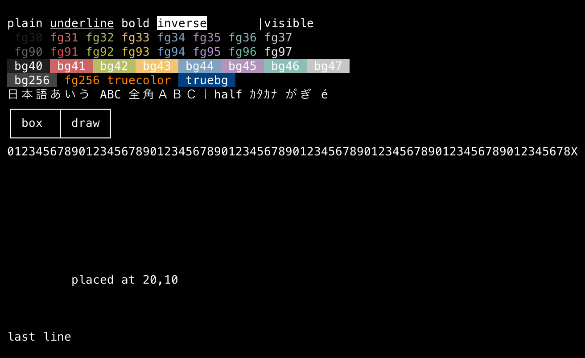

# uparupa

macOS 専用のターミナルエミュレータ。UI と描画は Swift（AppKit、Metal）、中核は Zig で書き、端末エミュレーションは [libghostty-vt](https://lib.ghostty.org/vt/) に任せている。



## 対応環境

- macOS 13 以上
- Apple Silicon（arm64）

## 今できること

- シェルの起動、キー入力、ウィンドウのリサイズ
- 16 色、256 色、24 ビット色、反転の表示
- 日本語や全角文字の表示（2 セル幅）と、IME で確定した文字の入力

まだできないこと: IME の変換中の文字列の表示、選択とコピー、貼り付け、スクロールバック、マウス操作、設定ファイル。

## インストール

```sh
curl -fsSL https://raw.githubusercontent.com/Matuyuhi/uparupa/main/install.sh | sh
```

- `~/Applications/uparupa.app` と `~/.local/bin/uparupa` が置かれる。管理者権限は使わない。
- 取得したファイルは、SHA-256 を確かめてから展開する。
- 入れるバージョンを指定するときは `UPARUPA_VERSION=v0.1.0` を付ける。

## 使い方

```sh
uparupa            # 開く
uparupa update     # 最新のリリースを入れ直す
uparupa --version
```

起動時に、新しいリリースが出ていないかを 1 日 1 回だけ GitHub に問い合わせる。知らせるだけで、自動では更新しない。止めるには環境変数 `UPARUPA_NO_UPDATE_CHECK=1` を設定する。

## 開発

必要なもの: Xcode 27（Metal Toolchain を含む）、Zig 0.17.x、minisign。

```sh
sh scripts/fetch-ghostty-vt.sh   # libghostty-vt を取得する（署名と SHA-256 を確かめる）
sh scripts/build-app.sh          # build/uparupa.app を作る
sh scripts/test.sh               # テスト一式
```

| 場所 | 中身 |
|---|---|
| `core/src/` | Zig の中核（PTY、libghostty-vt の呼び出し、フォントとグリフ、描画用データの組み立て） |
| `Sources/UparupaKit/` | Swift の UI、キー入力、Metal の描画 |
| `Shaders/` | Metal のシェーダ |
| `tests/` | 画面の比較に使う入力と基準の画像 |

バージョンは `build.zig.zon` の `.version` だけに書く。リリースは、同じ番号のタグ（`v0.1.0` の形）を push すると GitHub Actions が作る。

細かい決まりごとは `CLAUDE.md`、経緯と確認済みの事実は `docs/handoff.md` にある。

## ライセンス

MIT（`LICENSE`）。同梱している libghostty-vt などのライセンスは `THIRD_PARTY_LICENSES.md` にある。
