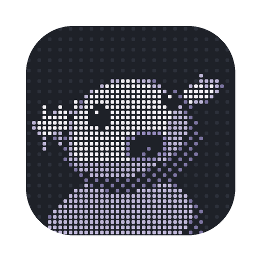

<p align="center">
  
</p>

<h1 align="center">upaa</h1>

<p align="center">A terminal emulator for macOS</p>

<p align="center">
  <a href="https://github.com/Matuyuhi/upaa/actions/workflows/test.yml"></a>
</p>

The UI and rendering are written in Swift (AppKit, Metal), the core in Zig, and terminal emulation is handled by [libghostty-vt](https://lib.ghostty.org/vt/).


## Requirements

- macOS 13 or later
- Apple Silicon (arm64)

## Status

Works today:

- Running a shell, keyboard input, window resizing
- 16-color, 256-color and 24-bit color, inverse and underline
- Japanese and other full-width text (two cells wide), and text committed from an input method
- Selecting text with the mouse (double-click for a word, triple-click for a line, Option-drag for a rectangle), Cmd-C and Cmd-A
- Pasting with Cmd-V, asking first when the text could run a command
- 10 MB of scrollback, scrolled with the wheel or trackpad
- Mouse input for programs that ask for it (vim with `mouse=a`, htop); hold Shift to select instead
- A config file for the font, colors and window size (see Configuration)
- Windows and tabs named after the title the program sets (Cmd-N, Cmd-T, Cmd-W, Cmd-Shift-[ and Cmd-Shift-], Cmd-1 to Cmd-9)

Not yet: splits, search.

## Install

```sh
curl -fsSL https://raw.githubusercontent.com/Matuyuhi/upaa/main/install.sh | sh
```

- Installs `~/Applications/upaa.app` and `~/.local/bin/upaa`. No administrator rights are needed.
- The download is verified against its SHA-256 checksum before it is unpacked.
- To install a specific version, set `UPAA_VERSION=v0.1.0`.

## Usage

```sh
upaa            # open the app
upaa update     # reinstall the latest release
upaa --version
```

On launch, upaa asks GitHub at most once a day whether a newer release exists. It only tells you; it never updates on its own. Set `UPAA_NO_UPDATE_CHECK=1` to turn the check off.

## Configuration

upaa reads `~/.config/upaa/config` (or `$XDG_CONFIG_HOME/upaa/config`) at launch. Each line is `key = value`; lines starting with `#` are comments (a `#` later in a line is part of the value). The keys and color syntax are Ghostty's, so these lines can be copied from a Ghostty config.

```
font-family = JetBrains Mono
font-size = 14
# window size in cells
window-width = 100
window-height = 30
foreground = #cdd6f4
background = #1e1e2e
# one of the 256 colors; repeat the line for others
palette = 1=#f38ba8
```

Colors are `#rrggbb`, `#rgb` or an X11 name. A line that cannot be read keeps the default, and the first one is shown in the window. Changes take effect the next time upaa starts.

## Development

You need Xcode 27 (with the Metal Toolchain), Zig 0.17.x and minisign.

```sh
sh scripts/fetch-ghostty-vt.sh   # download libghostty-vt (signature and SHA-256 are verified)
sh scripts/build-app.sh          # build build/upaa.app
sh scripts/test.sh               # run all tests
```

| Path | Contents |
|---|---|
| `core/src/` | Zig core: PTY, calls into libghostty-vt, fonts and glyphs, building the data to draw |
| `Sources/UpaaKit/` | Swift: UI, keyboard input, Metal rendering |
| `Shaders/` | Metal shaders |
| `tests/` | Inputs and reference images for the screenshot tests |

The version lives only in `.version` in `build.zig.zon`. To release, run the `release` workflow in GitHub Actions; it creates the tag and the release, then bumps `main` to the next patch version. Run the `bump-version` workflow with `minor` or `major` to change that.

Project conventions are in `CLAUDE.md` and the design history is in `docs/handoff.md` (both in Japanese).

## License

MIT (`LICENSE`). Licenses of the bundled libghostty-vt and its dependencies are in `THIRD_PARTY_LICENSES.md`.
